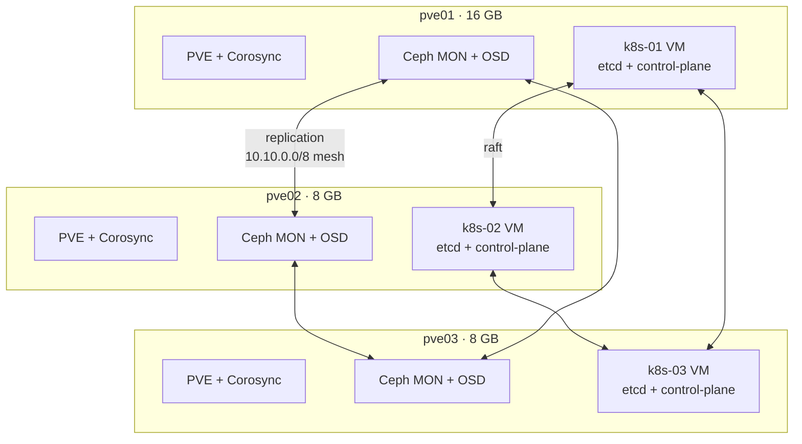

# Hyperconverged Kubernetes Roadmap

Target state: a 3-node Proxmox VE 9.2 + Ceph Tentacle cluster hosting a 3-node
Kubernetes cluster for Home Assistant and self-hosted services.

This document is both a build plan and a teaching reference. Each stage states
*what* to build, *why* that choice, and *which professional skill* it exercises.

---

## 1. Design principles

Five rules constrain every decision below. They are listed first because most
homelab failures come from violating them, not from bad component choices.

1. **One storage layer.** Ceph runs on Proxmox. Kubernetes consumes it through
   `ceph-csi`. Never run Rook-Ceph inside VMs that are already backed by Ceph —
   that nests replication inside replication and multiplies write amplification
   by 9×.
2. **One failure domain per node.** A Proxmox host, its Ceph OSD, its Ceph MON,
   and one Kubernetes VM all die together. Quorum math must assume that.
3. **State lives in exactly two places:** Ceph RBD (application data) and Git
   (desired configuration). Anything in etcd must be reconstructible from those.
   This rule is what makes the Talos migration in §7 affordable.
4. **Latency-sensitive writes stay local.** etcd is not a Ceph workload. See §4.
5. **Capacity is the binding constraint, not CPU.** 32 GB total RAM across the
   cluster is the number that decides what you can run.

---

## 2. Resource budget

The two 8 GB nodes are the hard constraint. Overhead figures below are measured
steady-state RSS, not configured targets — `osd_memory_target` is a *goal* the
OSD trims its cache toward, not a hard ceiling; actual RSS typically runs
1.2–1.5× the target.

| Component | pve01 (16 GB) | pve02 (8 GB) | pve03 (8 GB) |
|---|---|---|---|
| PVE host (kernel, pveproxy, pve-cluster, corosync) | 1.3 GB | 1.3 GB | 1.3 GB |
| ZFS ARC (capped, `zfs_arc_max_mb`) | 1.0 GB | 0.5 GB | 0.5 GB |
| Ceph OSD (target 768 MiB, real RSS) | 1.0 GB | 1.0 GB | 1.0 GB |
| Ceph MON | 0.5 GB | 0.5 GB | 0.5 GB |
| Ceph MGR (active / standby) | 0.5 GB | 0.2 GB | 0.2 GB |
| **Host overhead** | **~4.3 GB** | **~3.5 GB** | **~3.5 GB** |
| Kubernetes VM | 8.0 GB | 4.0 GB | 4.0 GB |
| **Free headroom** | **~3.7 GB** | **~0.5 GB** | **~0.5 GB** |
| zram swap (25%, zstd) | 4.0 GB | 2.0 GB | 2.0 GB |

> **Risk — the 8 GB nodes are tight.** 0.5 GB of headroom is not enough to absorb
> a Ceph recovery event, which transiently inflates OSD memory while backfilling.
> Two mitigations, in order of preference:
>
> 1. Provision the worker VMs at **3.5 GB** instead of 4 GB and raise them only
>    after observing real usage for a week.
> 2. Rely on zram (already configured in `pve-base`) to absorb spikes. Compressed
>    RAM swap is roughly 3× faster than SSD swap and avoids OOM-killing an OSD —
>    but an OSD that swaps is an OSD that gets marked `down` by its peers.
>
> Treat `MemAvailable < 400 MB` on pve02/pve03 as a page-worthy alert.

**Storage capacity:** 3 OSDs × ~860 GiB usable partition = ~2.5 TiB raw. With
`size=3, min_size=2` that is **~860 GiB logical**, and Ceph refuses writes at the
85% `nearfull` ratio, so plan against **~730 GiB usable**.

---

## 3. Quorum: the concept that governs everything

Three independent consensus systems run on these three machines. Each tolerates
exactly one node loss and each halts at two.

| System | Members | Quorum | Survives | Halts at | Consequence of loss |
|---|---|---|---|---|---|
| Corosync (Proxmox) | 3 | 2 | 1 node down | 2 down | Cluster config becomes read-only; running VMs keep running |
| Ceph MON | 3 | 2 | 1 node down | 2 down | All storage I/O blocks cluster-wide |
| etcd (Kubernetes) | 3 | 2 | 1 node down | 2 down | API server read-only; running pods keep running |



Three lessons that generalise to any production system:

- **Odd numbers only.** A 4-node cluster also tolerates only one failure (quorum
  of 3), so the fourth node adds cost and zero availability. 3 → 5 is the next
  real step up.
- **`min_size=2` is a correctness setting, not a performance one.** Lowering it
  to 1 during an outage lets writes continue against a single replica; if that
  disk then fails you have silently lost data with no second copy to recover
  from. It is an emergency lever, never a default.
- **Quorum loss ≠ data loss.** Losing quorum makes the control plane read-only.
  Running workloads usually survive. The instinct to reboot everything during a
  quorum incident is what converts an outage into data loss.

> **Note on PVE HA:** `pve_ha_enabled: false` is set deliberately. Proxmox HA and
> Kubernetes would otherwise both try to recover the same workload, and Proxmox
> HA fencing can hard-reset a node that Kubernetes considers healthy. Kubernetes
> owns workload failover; Proxmox owns only the virtual hardware.

---

## 4. Storage layout: why etcd does not go on Ceph

etcd fsyncs to disk on every write and expects a p99 `wal_fsync` under ~10 ms.
Ceph RBD with `size=3` must acknowledge writes on three OSDs across the 2.5 G
mesh before returning. That is tens of milliseconds under load. etcd responds by
losing leader elections, which looks like random API server unavailability and is
genuinely unpleasant to diagnose.

| Data | Location | Reason |
|---|---|---|
| k8s VM OS disk + etcd | **Local ZFS** on its host | Low-latency fsync; etcd replicates itself across the 3 VMs |
| Application PVs (Home Assistant, Postgres) | **Ceph RBD** via `ceph-csi` | Survives node loss; follows the pod |
| Container images | Local ZFS | Disposable cache, re-pullable |
| Backups | Ceph RBD, then off-cluster | See §9 |

Consequence: **the k8s VMs cannot live-migrate.** Each is pinned to its host.
That is correct for this design — Kubernetes provides availability at the pod
layer, so the VM is cattle. Losing pve02 means losing `k8s-02`; etcd keeps quorum
on the other two and pods reschedule.

This split — replicated-shared storage for application state, local fast storage
for consensus logs — is the same pattern used for production Kafka, etcd, and
database tiers. It is worth internalising.

---

## 5. Networking

```
Internet → Router 192.168.50.1
             │
          LAN switch ── eth-mgmt (1G) ──┬── pve01 → vmbr0 → k8s-01
                                        ├── pve02 → vmbr0 → k8s-02
                                        └── pve03 → vmbr0 → k8s-03

Cluster fabric (no switch, 3 direct cables):
  10.10.12.0/30  pve01 ↔ pve02      Ceph replication
  10.10.13.0/30  pve01 ↔ pve03      Corosync ring 1
  10.10.23.0/30  pve02 ↔ pve03      routed by FRR OSPF
```

| Concern | Decision | Why |
|---|---|---|
| Pod CIDR | `10.42.0.0/16` (k3s default) | No overlap with `192.168.50.0/24` or `10.10.0.0/8` |
| Service CIDR | `10.43.0.0/16` | k3s default |
| CNI | flannel VXLAN initially | Simplest; swap to Cilium when you want network policy and eBPF observability |
| LoadBalancer | MetalLB, L2 mode, pool `192.168.50.240–250` | dnsmasq is static-only and the router owns DHCP, so this range must be excluded from the router's pool |
| Ingress | Traefik (k3s built-in) | Already bundled; one less component on constrained RAM |
| TLS | cert-manager, DNS-01 via your DNS provider | DNS-01 avoids exposing port 80 to the internet |

> **MTU.** VXLAN adds 50 bytes of encapsulation. On a 1500-byte LAN the pod MTU
> becomes 1450. Mismatched MTU produces the worst class of bug in distributed
> systems: small packets succeed, large ones hang, and it presents as "the
> database is slow" rather than "the network is broken". Either accept 1450
> explicitly, or enable jumbo frames (MTU 9000) on the 2.5 G cluster links and
> keep Ceph traffic there. Verify with
> `ping -M do -s 8972 <peer>` before trusting it.

The cluster fabric carries Ceph and Corosync ring 1 only. Kubernetes traffic
rides `vmbr0` on the 1 G management link. If inter-pod bandwidth ever becomes the
bottleneck, the fix is to add a second VM NIC onto the mesh — not to move Ceph.

---

## 6. GitOps with Flux

Flux reconciles the cluster from a Git repository every few minutes. If a node
is rebuilt, the workloads come back without manual `kubectl apply`.

```
k8s-gitops/                     # separate repo from thinkcenter-cluster
├── clusters/home/
│   ├── flux-system/            # Flux's own manifests (bootstrapped)
│   └── infrastructure.yaml     # ordering: infra before apps
├── infrastructure/
│   ├── ceph-csi/               # RBD StorageClass + secrets (SOPS/SealedSecrets)
│   ├── metallb/
│   ├── cert-manager/
│   └── monitoring/
└── apps/
    ├── home-assistant/
    └── ...
```

Three practices that make this career-relevant rather than hobby-grade:

- **Pin every chart and image to a digest or exact version.** `latest` reintroduces
  the non-reproducibility that GitOps exists to eliminate.
- **Never commit plaintext secrets.** Use SOPS with age, or Sealed Secrets. This
  repo already uses `fnox` + Bitwarden for infrastructure credentials; the
  cluster repo needs its own equivalent because Flux must decrypt unattended.
- **Use `dependsOn` to order Kustomizations.** `ceph-csi` must be Ready before
  any workload with a PVC, or pods enter a crash loop that looks like a storage
  fault.

**Bootstrap is the one manual step.** `flux bootstrap github ...` is run once per
cluster; everything after is a Git commit. Record that command in the runbook —
you will need it again during the Talos migration.

---

## 7. Debian k3s now, Talos later

You asked whether to start on Debian and migrate, or adopt Talos immediately.

**Recommendation: start with k3s on Debian 13, with a hard constraint that no
cluster state exists outside Git and Ceph.** Rationale below, with the migration
cost stated honestly so the decision is reversible on evidence rather than vibes.

### What Talos actually changes

Talos is an immutable, API-driven OS. There is no SSH, no shell, no package
manager, no systemd units you can edit. The entire machine is defined by a YAML
machine config applied over a gRPC API with `talosctl`.

| Dimension | Debian + k3s | Talos Linux |
|---|---|---|
| RAM overhead per VM | ~500 MB | ~250 MB |
| Attack surface | Full distro, SSH, sudo | No shell, no SSH, read-only rootfs |
| Debugging | `ssh` + any tool you like | `talosctl logs/dmesg/read`; no interactive shell, ever |
| Config drift | Possible (someone edits a file) | Structurally impossible |
| Upgrades | `apt upgrade`, reboot | Atomic A/B image swap, automatic rollback |
| Learning curve | Low | Moderate — you must unlearn SSH |
| Kernel modules | `modprobe` anything | Only what Talos ships, plus system extensions |

### Why Debian first

1. **You are learning distributed systems, not OS immutability.** When Ceph-CSI
   fails to attach an RBD volume, being able to `ssh` in and run `rbd map`,
   `dmesg`, and `journalctl -u kubelet` turns a two-day mystery into a ten-minute
   fix. Talos makes that loop materially harder before you know what you are
   looking for.
2. **The hard parts of this build are not the OS.** Ceph tuning, CSI wiring, MTU,
   quorum behaviour, and Flux ordering are all identical on either OS.
3. **The migration is cheap *if* §1 rule 3 is respected.** Talos cannot be
   upgraded into from Debian — it is always a fresh cluster. That rebuild is a
   weekend if state is external, and a nightmare if it is not.

### Practices that keep the Talos door open

Adopt these from day one. Each one is independently good practice, so there is no
cost to the option value.

- **No `kubectl apply` by hand.** Everything through Flux. The cluster must be
  reconstructible from the Git repo alone.
- **No node-local workload state.** No `hostPath` volumes, no `local-path`
  StorageClass for anything you care about. All PVs on Ceph RBD.
- **No manual host tweaks inside the VMs.** If a sysctl or kernel module is
  needed, record it in the OpenTofu/Ansible definition — it becomes a Talos
  machine config patch later.
- **Document every manual bootstrap command** in `docs/runbook.md`.
- **Use `ceph-csi` with a static, documented Ceph user and pool.** The RBD images
  outlive any Kubernetes cluster.

### Migration sketch (M8)

The genuinely hard part is that **RBD images survive but PV/PVC objects do not** —
they live in etcd, which is destroyed with the old cluster.

1. Stand up Talos on a 4th temporary VM to practise `talosctl` with zero risk.
2. Quiesce workloads; take a Velero backup (including PV metadata) to an
   off-cluster target.
3. Record every `rbd` image name and its owning PVC: `rbd ls -p <pool> --long`.
4. Rebuild VMs with the Talos image via OpenTofu, one node at a time.
5. `talosctl bootstrap` the new etcd cluster; install `ceph-csi` first.
6. Either restore with Velero, or hand-author static PVs with
   `volumeHandle` set to the existing RBD image name and `persistentVolumeReclaimPolicy: Retain`.
7. `flux bootstrap` against the same repo; workloads reconcile onto the restored PVs.

**Decision gate — move to Talos when all three hold:**
- Flux has been the sole write path to the cluster for 30+ days.
- A full rebuild of one Debian node has been rehearsed successfully.
- A Velero restore of a Ceph-backed PVC has been verified end-to-end.

If any is false, the migration will teach frustration rather than architecture.

---

## 8. Home Assistant

Home Assistant is a **stateful single-replica** workload: a SQLite or Postgres
recorder database on an RWO volume. It cannot scale horizontally, so availability
comes from fast rescheduling, not redundancy.

- **Radio: network coordinator (SLZB-06 over PoE/Ethernet).** This is the single
  most important choice. USB passthrough pins Home Assistant to one physical
  node and silently negates the entire cluster. A network coordinator speaks
  Zigbee over TCP, so the pod can land on any node.
- **Recorder: Postgres on Ceph RBD**, not SQLite. SQLite over a network block
  device with an unclean failover risks corruption; Postgres handles crash
  recovery properly.
- **Expect 3–8 minutes of downtime on node failure**, not seconds. The sequence
  is: node NotReady (~40 s) → pod eviction timeout (default 5 min) → RBD volume
  detach → reattach → container start. Tune
  `tolerationSeconds` on `node.kubernetes.io/unreachable` to shorten it, but be
  aware you are trading against split-brain risk.

> **The multi-attach trap.** When a node dies *hard* (power loss), Kubernetes
> cannot confirm the old pod released the RWO volume, so it refuses to attach it
> elsewhere until the node object is deleted or the volume is force-detached.
> Pods sit in `ContainerCreating` with `Multi-Attach error for volume`. Practise
> the recovery in §10 before you meet it at 2 a.m.

---

## 9. Observability and backup

`kube-prometheus-stack` is the common default and needs 1.5–2 GB. That does not
fit here. Use a lighter stack:

| Function | Choice | RAM |
|---|---|---|
| Metrics | VictoriaMetrics single-node, 15-day retention | ~300 MB |
| Dashboards | Grafana | ~150 MB |
| Logs | Skip initially, or Loki with filesystem storage and 7-day retention | ~200 MB |
| Alerting | vmalert → ntfy or email | ~50 MB |

Scrape the Proxmox PVE exporter, Ceph's built-in MGR Prometheus module, and
node-exporter. Four alerts matter more than fifty dashboards:

1. `MemAvailable < 400 MB` on any node — the §2 risk.
2. Ceph health `!= HEALTH_OK` for > 10 minutes.
3. Any Corosync, MON, or etcd member down.
4. etcd `wal_fsync` p99 > 25 ms — the §4 failure mode, visible before it bites.

**Backups, in increasing order of value:**
- Proxmox `vzdump` of the k8s VMs to Ceph — fast rebuild of a VM.
- Velero with the CSI snapshot plugin — PVC-level restore and the migration tool from §7.
- **Off-cluster copy of Velero output.** A backup stored only on the Ceph cluster
  it protects is not a backup. Push to a NAS or object storage.

---

## 10. Failure drills

Scheduled, deliberate failure is the only way to know whether the design works.
Run each once, record the observed behaviour, and compare against the prediction.

| Drill | Method | Expected outcome |
|---|---|---|
| Graceful node reboot | `ha-manager disarm-ha`, reboot pve03 | Ceph `HEALTH_WARN`, pods reschedule, no data loss |
| Hard node loss | Pull power on pve03 | Quorum holds at 2/3; expect the multi-attach delay from §8 |
| Disk failure | `ceph osd out <id>` | Backfill begins; watch OSD memory on the 8 GB nodes |
| Quorum loss | Power off two nodes | Everything read-only; verify it **recovers on power-up without intervention** |
| Restore test | Delete a PVC, restore from Velero | Data intact; time the full procedure |
| Network partition | Unplug one mesh cable | OSPF reroutes via the third node within seconds |

The last one is the payoff for the full-mesh design: the triangle means any
single cable can fail and FRR reconverges over the remaining path.

---

## 11. Milestones

| ID | Milestone | Acceptance criteria |
|---|---|---|
| **M0** | Bare-metal validation | 3 nodes PXE-install unattended; `pvecm status` shows 3/3 quorate |
| **M1** | Ceph operational | `ceph -s` is `HEALTH_OK`; `ceph-vm` pool exists with `size=3, min_size=2` |
| **M2** | VM provisioning | OpenTofu (`bpg/proxmox`) creates 3 VMs with local-ZFS disks, pinned to hosts |
| **M3** | Kubernetes up | k3s with embedded etcd, 3 control-plane nodes; `kubectl get nodes` shows 3 Ready |
| **M4** | Storage wired | `ceph-csi` StorageClass; a test PVC binds and survives pod reschedule |
| **M5** | GitOps + networking | Flux reconciling; MetalLB issues an external IP; cert-manager issues a valid cert |
| **M6** | Home Assistant live | HA on Ceph RBD with Postgres; SLZB-06 paired; survives node drain |
| **M7** | Observability + backup | Four alerts firing correctly; one verified Velero restore |
| **M8** | Talos decision gate | §7 criteria evaluated; migrate or document why not |

Do not start M3 before M1 is `HEALTH_OK` for a week under real load. A Kubernetes
cluster on unstable storage produces failures that are nearly impossible to
attribute correctly.

---

## 12. Mapping to platform engineering skills

Each milestone maps onto something that appears in platform engineering job
descriptions and interviews.

| Work in this roadmap | Professional skill |
|---|---|
| Ceph `size`/`min_size`, OSD recovery, `nearfull` | Distributed storage operations and capacity planning |
| Corosync / MON / etcd quorum (§3) | Consensus, split-brain, and failure-domain reasoning |
| etcd off Ceph (§4) | Workload-aware storage tiering; latency budgets |
| OSPF mesh, MTU, MetalLB, CIDR planning (§5) | Network engineering for container platforms |
| Flux, pinned versions, `dependsOn` (§6) | GitOps and declarative delivery |
| OpenTofu VM provisioning (M2) | Infrastructure as code |
| Talos evaluation (§7) | Immutable infrastructure; migration planning and risk assessment |
| Velero restores, off-cluster copies (§9) | Disaster recovery; RTO/RPO as measured numbers |
| Failure drills (§10) | Chaos engineering and operational readiness |
| ADRs in `docs/adr/` | Architecture decision records — rare and well-regarded |

The highest-signal artefacts for an interview are the ones most people skip:
the **failure drill results with measured recovery times**, the **ADRs that
record rejected options and why**, and the **investigation write-up** in
`docs/investigations/pxe-uefi.md` showing a hard bug diagnosed to root cause.

---

## References

- [ADR 0001 — PVE 9.2 and Ceph Tentacle](adr/0001-pve-9-2-and-ceph-tentacle.md)
- [ADR 0002 — Interim single-SSD partitioning](adr/0002-interim-single-ssd-partitioning.md)
- [ADR 0003 — Full-mesh OSPF cluster fabric](adr/0003-full-mesh-ospf-cluster-fabric.md)
- [Storage migration — single SSD to NVMe + SSD](storage-migration.md)
- [SDN learning path](sdn-learning-path.md)
- [Day-0 runbook](runbook.md)
